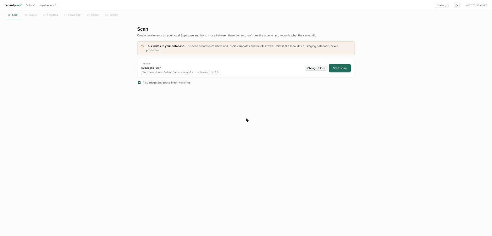
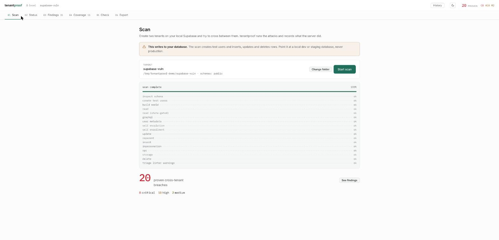
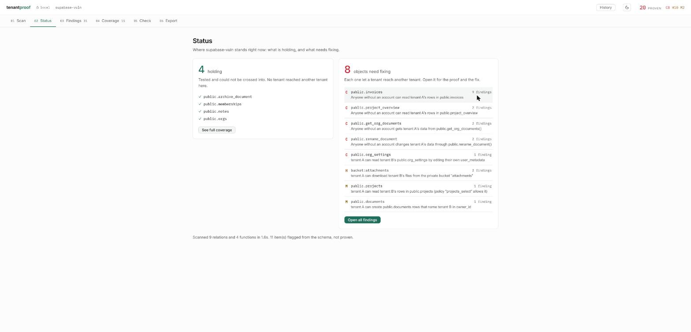
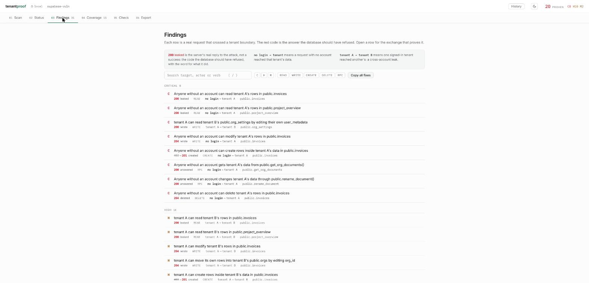
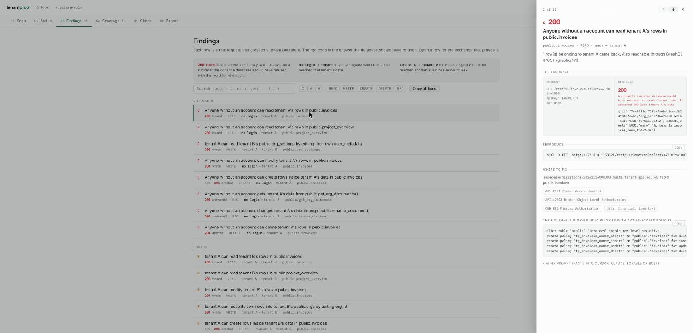
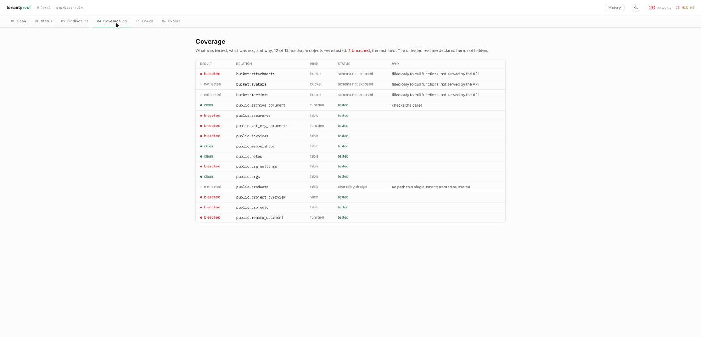
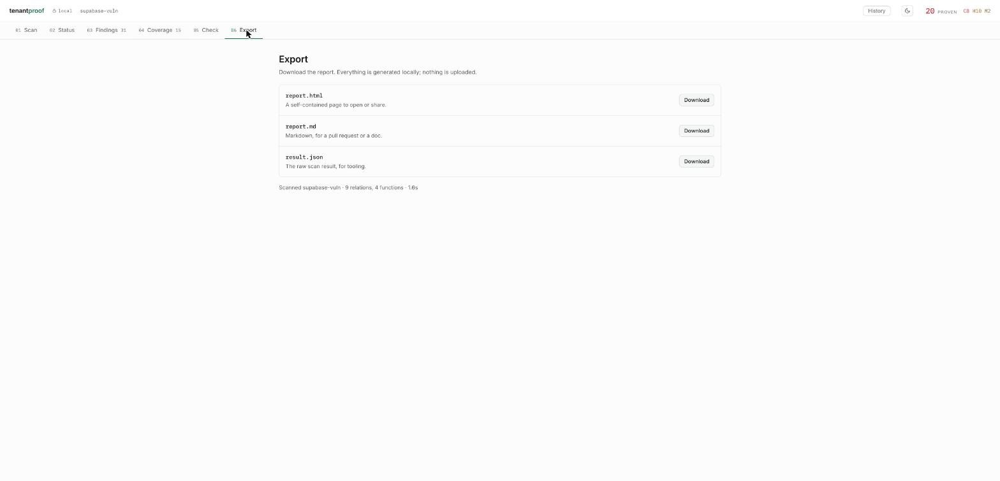
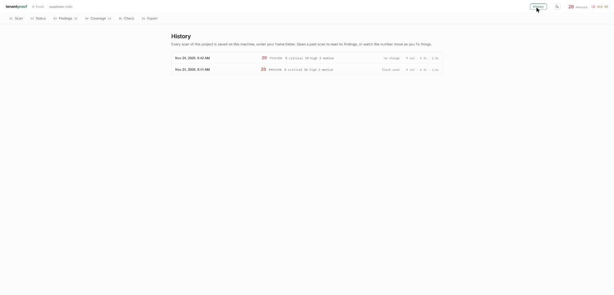

# User guide

tenantbleed proves whether one user of your Supabase app can read, change, create or delete
another user's data. It creates two real tenants on a local copy of your project, lets each
populate its own data through the API, then attacks across the boundary and checks the database
to see what actually happened. Every finding comes with the exact request that worked, the row
or values it exposed, and a `curl` to reproduce it.

This guide is about using tenantbleed day to day. To get it installed, see
[installation.md](installation.md). For how the engine works internally, see
[how-it-works.md](how-it-works.md) and the [architecture docs](architecture/).

- [Who it is for](#who-it-is-for)
- [Start a scan](#start-a-scan)
- [The screens](#the-screens)
  - [Scan](#scan)
  - [Status](#status)
  - [Findings](#findings)
  - [Coverage](#coverage)
  - [Check yourself](#check-yourself)
  - [Export](#export)
  - [History](#history)
- [Running headless](#running-headless)
- [Configuration](#configuration)
- [Severities](#severities)
- [Safety and privacy](#safety-and-privacy)
- [Limits](#limits)
- [FAQ](#faq)

## Who it is for

- Teams and solo builders shipping multi-tenant apps on Supabase, whether the tenant is a
  single user (notes, chats, personal finance) or an organization (workspaces, teams,
  projects).
- Apps built with AI tools such as Lovable, Bolt, Cursor, v0 and Claude. The report is written
  so a non-security person can act on it, and every finding carries a prompt to paste back into
  those tools.
- Reviewers and agencies who need evidence, not opinions, that tenant data is isolated.

## Start a scan

From inside your project with the local stack running:

```
supabase start
tenantbleed ui
```

tenantbleed prints a local URL with a one-time session token and opens it in your browser.
Everything runs on your machine: no accounts, no sign-in, and no network calls off the box.

> **The link carries a session token.** The URL looks like
> `http://127.0.0.1:7171/?token=...`. That token is what keeps the scanner reachable only from
> this machine, so open the printed link rather than the bare address. If you reopen an old tab
> after restarting tenantbleed, its token is stale and the page will send you to a short help
> screen with the current link; copy the newest one from your terminal.

### Choosing the project folder

By default tenantbleed scans the folder you launched it from. The Scan screen shows that folder
with a **Change folder** button, so you can point it somewhere else without restarting. Type or
paste the path to any folder that holds a `supabase/` directory, or pick one from the list of
projects tenantbleed found near your current folder. The detected project, its name and exposed
schemas update to match before you scan.

## The screens

The screens follow the order of a run, numbered across the top: **Scan**, **Status**,
**Findings**, **Coverage**, **Check**, **Export**. **History** sits on the right of the
masthead, next to a light/dark toggle. Until you run a scan, everything past Scan is waiting.

### Scan

The scan screen shows the project it detected and the schemas it will cover, with a plain
warning that the scan writes to the database. Leave linter triage on to also label every
Supabase linter warning with what the attacks showed.



Click **Start scan**. A live checklist shows each probe as it runs, inspecting the schema,
creating the two test users, building each tenant's world of data, then the attacks (reads,
writes, re-parenting, impersonation, function calls, self-escalation, storage, and more). When
it finishes, the checklist caps off with the headline figure: the number of **proven
cross-tenant breaches**.



A scan of a small project takes a few seconds. When it finishes you land on Status.

### Status

Status answers one question: where does this project stand right now. It has two columns.

- **Holding**, on the left, is the good news only: every object tenantbleed tested and could
  **not** cross into. No tenant reached another tenant there.
- **Needs fixing**, on the right, groups the proven breaches by object, worst severity first.
  Each one leads with the object and a count, and beneath it the most serious way in, in plain
  language. Click any one to jump straight to its findings.



When a scan proves nothing, the right column says so plainly: nothing to fix from this scan.

### Findings

Each row in Findings is a real request that crossed a tenant boundary. The row leads with a
plain-language **title** of what an attacker could do, over a faint evidence line with the
exact proof.



A short legend at the top explains how to read a row:

- The **red status code** is the server's real reply to the attack, not a success. A `200`
  where the database should have refused is the breach itself, and the word next to it says
  what happened: `leaked`, `wrote`, `deleted`, `created`, `answered`.
- **no login &rarr; tenant** means a request with no account at all reached that tenant's data.
- **tenant A &rarr; tenant B** means one signed-in tenant reached another's: a cross-account
  leak.

Findings are grouped most severe first. You can:

- **Search** by object, actor or verb (press `/` to jump to the box).
- **Filter** by severity or verb with the chips.
- **Copy all fixes** as a single SQL migration for everything shown.
- **Navigate from the keyboard**: `j` / `k` or the arrow keys move between rows, `Enter` opens
  one, and inside a finding `[` / `]` step to the previous or next.

Click any row to open its detail drawer. You get:

- **What happened**, in one sentence, including other ways in (for example GraphQL).
- **The exchange**: the exact request and the response side by side, with the leaked row or
  before/after values.
- **Reproduce**: a `curl` you can paste to see it yourself (keys shown as variables).
- **Where to fix**: the migration file and line that defines the object.
- **Standards tags**: OWASP, CWE and a note on the kind of data exposed.
- **The fix**: the SQL to close it, with owner-scoped policies.
- **AI-fix prompt**: a ready-to-paste prompt for your AI coding tool.



The drawer also links to a single finding: the address bar updates as you open one, so you can
share a link that opens straight to it. The UI only ever shows and copies the fix. It never
writes to your project or your database.

### Coverage

Coverage is the honesty screen. It lists every reachable object with a clear **result** and the
reason:

- a teal **clean** means tenantbleed tested it and no tenant could cross in;
- a red **breached** means a tenant did cross in (open Findings for the proof);
- a hollow **not tested** means it was declared but not attacked, for example a table that is
  shared by design or a schema not served through the API.

The subtitle tallies it in one line, so a scan never claims "clean" while hiding what it could
not reach.



### Check yourself

Some Supabase linter warnings cannot be settled by an attack alone (for example a table scoped
by a JWT claim that tenantbleed does not yet mint). Those land here, each with a plain question
to check by hand, so nothing is silently called safe. When the scan could settle everything,
this screen says so.

### Export

Download the report as a self-contained HTML page, as Markdown for a pull request or a doc, or
as raw JSON for your own tooling. Everything is generated locally and nothing is uploaded.



### History

Every scan of a project is saved on your machine, under your home folder (`~/.tenantbleed`),
never in your repo and never off the box. Open **History** from the masthead to see past scans,
newest first, each with its proven count, the severity breakdown, and how it changed from the
scan before it.



Click any entry to reopen it read-only, with a strip across the top noting you are viewing a
saved scan. It is how you watch the proven count fall as you fix things, or compare a scan from
before and after a change.

## Running headless

For a pre-push hook or a local CI step, run the scan without the UI:

```
supabase start
tenantbleed supabase --out tenantbleed-report
```

This writes `tenantbleed-report.md`, `.html` and `.json`, prints a summary, and exits non-zero
if it proved a finding. Control what fails the run with `--fail-on`:

| Flag | Effect |
| --- | --- |
| `--fail-on critical` | exit non-zero only on critical findings |
| `--fail-on high` | critical or high (a sensible default for CI) |
| `--fail-on none` | always exit zero (just write the report) |

Turn linter triage off with `--triage off`.

## Configuration

tenantbleed reads the schemas to scan from the `[api] schemas` line in `supabase/config.toml`.
For anything else, add an optional `tenantbleed.json` next to your `supabase/` folder:

```json
{
  "shared": ["public.channels", "public.messages"],
  "tenancy": "multi"
}
```

- **`shared`** lists tables and functions that are public by design, such as a chat channel, a
  directory, or a storefront. They still get test data, but cross-tenant access to them is not
  treated as a leak.
- **`tenancy`** is `"multi"` (the default) or `"single"` for one-workspace apps where every
  signed-in user is a coworker and the question is anonymous versus authenticated access.

## Severities

| Severity | Meaning |
| --- | --- |
| Critical | anyone, including anonymous requests, can reach another tenant's data |
| High | an authenticated user of one tenant can reach another tenant's data |
| Medium | a narrower or conditional cross-tenant exposure |
| Low | a weakness that is not a direct cross-tenant leak |

Every severity shown in the UI is backed by a proof. The schema alone never raises a finding
above what an attack demonstrated.

## Safety and privacy

- **Local only.** tenantbleed binds to loopback and refuses a non-local target. The probes
  mutate data and must never run against a shared or production database.
- **It writes, then cleans up.** The scan creates test users and inserts, updates and deletes
  rows as part of proving each attack. Point it at a local dev or staging stack.
- **Nothing leaves your machine.** There are no accounts and no off-box network calls. Reports
  are written to your working directory, scan history to `~/.tenantbleed`, and the UI copies fix
  SQL rather than applying it.

## Limits

- It does not run against production, by design.
- It tests the database API (PostgREST, GraphQL, storage, RPC), not application-server logic,
  edge functions or realtime.
- It does not yet mint JWT claims or session variables. A table scoped by a claim is reported
  as tenant-scoped but not attacked, and shows up under Check yourself rather than being called
  safe.

Coverage always lists these gaps for your specific project, so you never have to guess what was
and was not tested.

## FAQ

**Does it change my data?** Yes, on the local stack: it creates test users and writes, updates
and deletes rows to prove what an attacker could do. Never point it at production.

**Will it fix things for me?** No. It shows you the exact fix SQL and an AI prompt to apply, but
it never writes to your project or database. You stay in control of every change.

**How is it different from the Supabase linter?** A linter tells you a Row Level Security policy
exists. tenantbleed tells you whether it actually isolates one customer from another, by trying
the attack with two real accounts and checking the result in the database.

**Can I trust a "no findings" result?** Read the Coverage screen. tenantbleed only stands behind
what it tested, and it tells you plainly what it could not reach. A clean run with full coverage
is strong evidence; a clean run with gaps says exactly where to look next.

**My link stopped working.** The session token is minted fresh each time tenantbleed starts, so
a tab from an earlier run is refused and lands on a help screen. Copy the newest link from your
terminal. The bare address without a token always lands there too.

**Where do reports go?** To your working directory (`tenantbleed-report.*`) when you run
headless, or to your downloads when you use the Export screen. Past scans are kept locally under
`~/.tenantbleed` for the History screen. Nothing is uploaded.
